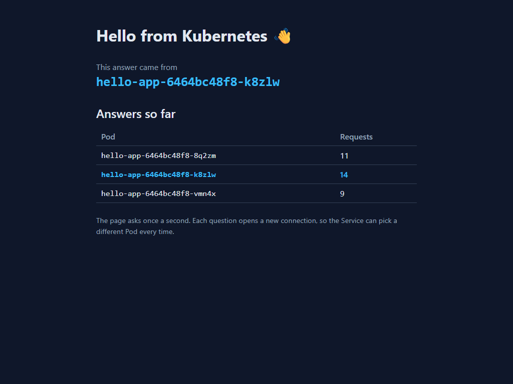

# Lab 2 — hello-app on Kubernetes

Your copy of this repository is your submission. The lab sheet is on the course site; this file is where you record what you did.

What's here:

| File | What it is |
|---|---|
| `src/`, `index.html` | a small React page that shows which Pod answered |
| `nginx.conf` | serves the page, and answers `/whoami` with the Pod name |
| `Dockerfile` | builds the page, then serves it with nginx on port 80 |

You don't change any of these. You add `hello-app.yaml` and fill in the sections below.

## Before you push, check

- [x] `hello-app.yaml` is in the root of this repository
- [x] `screenshot.png` is in the root of this repository
- [x] every section below is filled in

---

## 1. My image

Docker Hub image I deployed (for example `ravi123/hello-app:v1`):

```
shashankbanasi/hello-app:v1
```

## 2. Pods across nodes

Output of `kubectl get pods -o wide` after you applied `hello-app.yaml`:

```
NAME                         READY   STATUS    RESTARTS   AGE   IP           NODE              NOMINATED NODE   READINESS GATES
hello-app-6464bc48f8-8q2zm   1/1     Running   0          52s   10.244.1.2   desktop-worker    <none>           <none>
hello-app-6464bc48f8-k8zlw   1/1     Running   0          52s   10.244.2.2   desktop-worker2   <none>           <none>
hello-app-6464bc48f8-vmn4x   1/1     Running   0          52s   10.244.1.3   desktop-worker    <none>           <none>
```

## 3. The Service and its endpoints

Output of `kubectl get service hello-app` and `kubectl get endpointslices -l kubernetes.io/service-name=hello-app`:

```
NAME        TYPE           CLUSTER-IP      EXTERNAL-IP   PORT(S)          AGE
hello-app   LoadBalancer   10.96.182.204   172.21.0.8    8080:31245/TCP   55s

NAME                ADDRESSTYPE   PORTS   ENDPOINTS                           AGE
hello-app-7h49m     IPv4          80      10.244.1.2,10.244.2.2,10.244.1.3   55s
```

## 4. Browser

Add `screenshot.png`: the page at `http://localhost:8080` with at least two Pods in the "Answers so far" table.



## 5. The four traps

For each trap, write what you saw and why it happened, in two or three lines of your own words.

**Trap 1 — the local image.**
When creating the deployment with `hello-app:v1`, the Pods were stuck in `ErrImagePull` / `ImagePullBackOff`. Each cluster node runs as an isolated machine with its own image storage and cannot see images stored locally on the host laptop. Kubernetes attempted to pull the unprefixed image from official Docker Hub repositories where it did not exist.

**Trap 2 — the selector typo.**
When `spec.selector.app` was changed to `helo-app`, the Service still existed, but its `EndpointSlice` became completely empty (`ENDPOINTS: <none>`). No Pods matched the misspelled label selector, causing the Service to have zero backend target endpoints and the browser to fail connecting to the application.

**Trap 3 — the wrong targetPort.**
Changing `targetPort` to `8080` kept the Pod endpoints registered in the `EndpointSlice`, but routed incoming requests to port 8080 inside the container. Because nginx inside the container listens strictly on port 80, the TCP connection was refused, resulting in HTTP connection errors in the browser.

**Trap 4 — the EXTERNAL-IP address.**
Attempting to open the private subnet `EXTERNAL-IP` (e.g., `http://172.21.0.8:8080`) directly from the laptop browser failed to load because that IP address belongs to the internal cluster/Docker bridge network and is not routable from the host OS. Accessing `http://localhost:8080` succeeded because Docker Desktop/Kubernetes publishes LoadBalancer ports directly onto localhost.

## 6. Your YAML vs the generated YAML

Name two fields in the `--dry-run=client -o yaml` output that were not in your file. Why does your file still work without them?

1. `creationTimestamp: null` (in `metadata`): Metadata field managed by Kubernetes API server to track object creation time.
2. `strategy: { type: RollingUpdate, rollingUpdate: { maxSurge: 25%, maxUnavailable: 25% } }`: The default deployment rollout strategy.

Our handwritten manifest works without them because Kubernetes uses sensible default values and schema defaults for all omitted optional fields when creating the resources in the cluster.
